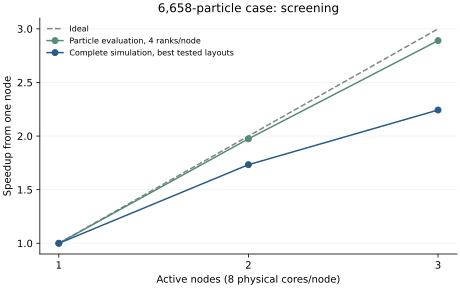
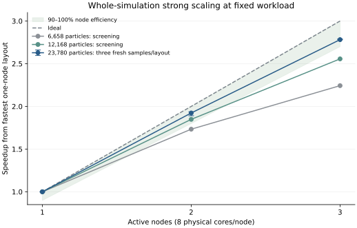

# ParallelCluster validation log

The initial target-partition implementation passed the DJI hover comparison but
scaled poorly: three nodes took 15.282 s versus the 20.563 s threaded serial
baseline (1.346x). Subsequent source partitioning, thread scheduling, callback
synchronization and distributed rotor preprocessing are evaluated below. Report
node scaling against the fastest validated one-node implementation with the same
physical-core budget, independently of improvements over the original serial code.

Objective: reduce elapsed time for one coupled simulation. Compare a matched
single-node run with two and three compute nodes. Numerical agreement is required
within declared tolerances; bitwise equality is not required.

Case source: [DJI 9443 rotor in hover](https://flow.byu.edu/FLOWUnsteady/examples/rotorhover-aero/).
The pilot keeps the tutorial's mid-low-fidelity model (Euler, inviscid, no SFS,
near-zero advance ratio, published hub/tip correction and initial hub-wake
suppression), with fewer blade elements and particle sheds. This checks the
implementation; it does not establish aerodynamic accuracy or converged hover.

## Original pilot and baseline measurements

The two-bladed DJI 9443 case uses eight elements per blade, 36 steps/revolution,
two particle sheds/step and four revolutions at 5,400 RPM. Advance ratio is
`1e-4`; density is 1.071778 kg/m^3. The simulation completes 144 steps with 6,658
particles. It uses Float64, rVPM/Euler, inviscid diffusion, no SFS, the tutorial's
hub/tip correction and initial hub-wake suppression released at revolution three.
FMM settings are fixed: `p=12`, `ncrit=min_ncrit=64`, relative tolerance `1e-7`,
absolute tolerance `1e-10`, and no order/leaf-size autotuning.

Job `10` completed all twelve measurements in 21m52s. Each fresh process ran a
complete same-case warmup before the timed simulation; `check_state=false` for
timings. Every candidate, including repeated serial runs, passed nine input
identity checks and 35 numerical checks against the first serial reference.
All recorded normalized L2/max errors were zero. No acceptance tolerance was
loosened and no aerodynamic model was changed to obtain agreement.

| Active nodes | Mode | Ranks | Threads/rank | Runs | Median s | Min-max s | Speedup |
| --- | --- | --- | --- | --- | --- | --- | --- |
| 1 | Serial | 1 | 8 | 3 | 20.563 | 20.447-20.755 | 1.000 |
| 1 | MPI | 1 | 8 | 3 | 21.511 | 21.497-21.702 | 0.956 |
| 2 | MPI | 2 | 8 | 3 | 16.605 | 16.562-16.730 | 1.238 |
| 3 | MPI | 3 | 8 | 3 | 15.282 | 15.241-15.389 | 1.346 |

Each active node uses its eight physical cores; Slurm advertises 16 vCPUs because
SMT is enabled. The sequential comparison allocation reserves all three nodes,
but each layout launches only on the listed number of hosts. These are active
compute counts, not an AWS billing estimate. Three nodes reduce measured elapsed
time by 25.7%, with 44.9% efficiency relative to ideal three-node scaling.
Peak process RSS across the repeated MPI runs was 4.69 GiB, including imports,
compilation and warmup.

The bounded runs require the explicit deferred-GC workaround described below.
Cleanup collection is included in elapsed time; artifact export is excluded.
Longer/higher-fidelity production runs need a proper PyCall threading/finalizer
solution before this policy can be generalized.

Evidence: [complete repeated comparisons](assets/mpi-cluster/benchmark-comparison.json),
[median summary](assets/mpi-cluster/benchmark-summary.csv),
[individual measurements](assets/mpi-cluster/benchmark-summary-runs.csv).

## 2026-10-13: preparation

- Connected to the supplied head node. Its host key was previously unknown;
  SSH `StrictHostKeyChecking=accept-new` enrolled it without overriding a changed
  key. Noninteractive SSH does not load Slurm/modules into PATH, so subsequent
  commands use `/opt/slurm/bin` and source `/etc/profile.d/modules.sh`.
- Queue `compute` contains three dynamic `c6a.4xlarge` nodes, each advertising
  16 Slurm CPUs and 31,129 MB memory. Initially all were powered down and no jobs
  were queued. `/home` is exported by the head node to compute nodes.
- Isolated task directory: `/home/ubuntu/flowunsteady-mpi-20261013`.
  Existing source changes are copied into `code`; the application has a private
  Julia depot/runtime and Python environment. No existing cluster workspace is
  overwritten.
- Available MPI modules: Open MPI 4.1.7, Open MPI 5.0.9, Intel MPI 2021.18.
  Initial choice: Open MPI 4.1.7, configured explicitly through MPIPreferences.
  Installation/precompilation and simulation jobs run through `sbatch`.
- Found and fixed a callback synchronization gap: the tutorial mutates the
  externally captured `omit_shedding` vector. The MPI driver now broadcasts this
  known solver control after the root callback, preserving its local identity.
  Without this fix workers would shed a different wake on the next step.

Acceptance thresholds, fixed before examining cluster results:

- Particle counts, clocks and discrete/static flags agree exactly; all numeric
  state is finite.
- Each physical state group and load/circulation history must satisfy both a
  normalized L2 error <= `1e-5` and a scaled maximum absolute error <= `5e-5`.
  The comparison script records the units, scales and zero-reference floors.
- Audit all 46 active particle rows, with separate position, strength, core,
  velocity, gradient and auxiliary groups. Do not combine fields with different
  units into one error norm.
- Use the same case, integration, precision and fixed FMM settings in all runs.
  If a comparison fails, investigate the implementation or tighten the common
  FMM accuracy settings and repeat every baseline; do not loosen acceptance.

Timing excludes compilation warmup and artifact export, and includes coupling,
integration, shedding and runtime callbacks. Report the slowest rank's elapsed
time and repeat measured runs. In the initial target-partition study, the threaded
ordinary serial run was the primary single-node baseline and one-rank MPI measured
adapter overhead. The later strong-scaling study uses the fastest validated
eight-core one-node implementation, including alternate MPI layouts.

Further job IDs, observed outcomes and numerical/performance results are appended
below as testing proceeds.

- Setup job `2` started a compute node but exited before installation: the batch
  shell's initial module search path did not include `/opt/amazon/modules/modulefiles`.
  Both Slurm scripts now explicitly add that directory. This was an environment
  initialization issue, not a solver failure.
- Local two-rank/two-thread regressions passed after the shedding-mask fix
  (106/104 assertions); the intentional root-output failure also terminated
  without leaving workers blocked.
- Setup job `3` confirmed AMD EPYC 7R13, eight physical cores and two hardware
  threads per core (16 vCPUs). Its Python setup stopped because the node lacks
  `ensurepip`. The task now uses an isolated `uv` executable to create/install the
  environment, avoiding system package changes. MPI runs use eight Julia threads
  per rank, bound to the eight physical cores.
- Slurm accounting storage is disabled on this cluster; job state/logs and
  application-recorded rank timings/RSS provide the run evidence instead of
  `sacct` history.
- Local rotor pilot (two ranks, two threads) exposed a Python/PyCall garbage
  collection crash during a longer warmup, in `pydecref` / NumPy deallocation.
  This matches the failure class in [PyCall issue 1072](https://github.com/JuliaPy/PyCall.jl/issues/1072).
  The upstream GIL/finalizer fix is still an unmerged pull request. For this
  bounded pilot, an explicit `--gc-policy deferred` option postpones Julia GC
  during each simulation and collects afterward on the initiating thread; the
  cleanup cost remains included in elapsed time. Use the same policy in every
  baseline and record peak RSS. This is an integration workaround, not a physics
  change or a demonstrated policy for long production runs.
- All source work is on branch `feat/mpi-single-simulation`.
- Setup job `4` installed the isolated Python environment and selected system
  Open MPI, then stopped because copied Conda build metadata retained the local
  workstation path. Setup now rebuilds Conda and PyCall in the cluster depot
  before precompilation; downloaded package sources/artifacts remain pinned.
- Setup job `5` exposed an MPI ABI collision: HDF5_jll imports OpenMPI_jll 5,
  whose Fortran products attempted to load alongside system Open MPI 4.1.7
  (`undefined symbol: ompi_instance_count`). It was cancelled after this failure
  was identified. Setup now selects installed Open MPI 5.0.9 and explicitly
  overrides all four OpenMPI_jll library products plus its launcher to that same
  installation. `OPAL_PREFIX` also points at the system installation, preventing
  bundled component discovery. MPI preferences remain local and uncommitted.
- Setup job `6` revealed that importing MPIPreferences with the previous system
  selection had already loaded MPI 4 into the configuration process. Attempting
  to discover MPI 5 in that process crashed during `dlclose`. Setup now clears
  the task-local MPI selection using TOML before importing MPIPreferences in a
  fresh process; it never loads two MPI installations together.
- Full local deferred-GC pilot completed at 144 steps / 6,658 particles on
  eight threads per rank. The serial versus two-rank comparison passed every
  declared state/load/history threshold; peak process RSS stayed below 5 GB.
- Setup job `7` completed successfully: Julia 1.13.1, Python 3.12.3, system
  Open MPI 5.0.9amzn1 and all pinned FLOW dependencies import together.
  The local pilot's recorded numerical differences were zero in every field and
  history; cluster equality remains to be established by the distributed runs.
- Validation job `8` placed one rank on each of the three distinct compute
  hosts, bound to cores 0-7. Its smoke test then stopped on a test-harness bug:
  `all` was given per-rank bit vectors instead of scalar predicates. The nested
  assertion is corrected. No aerodynamic comparison ran in this job.
- Validation job `9` passed the three-node smoke test: distinct hosts, binding
  to all eight physical cores, 800,000-byte-per-rank Allgather, matching MPI
  versions, and all four loaded MPI libraries from `/opt/amazon/openmpi5`.
  The inter-node transport is explicitly Open MPI `ob1` / TCP on the private
  subnet; these nodes expose no EFA device.
- The comparison now also requires identical hashes of all dependency identities,
  the application manifest and the complete rotor database, plus matching
  Python/NumPy/SciPy versions. An injected dependency-version mismatch was
  rejected in the local smoke test.
- Job `9`: distributed regression suite passed on all three nodes (106 checks
  on the output-owning rank, 104 on each worker), including coupled wing/rotor,
  RK3/SFS, callback synchronization and output. The reference hover run completed
  144 steps with 6,658 active particles; warmup 47.045 s, timed run 20.686 s.
- Job `9` completed successfully. Every MPI layout passed all nine input identity
  checks and all 35 numerical checks. Recorded state, circulation and load
  differences were zero; clocks, counts and shedding-mask histories agreed
  exactly. The case exercised suppression through revolution three and subsequent
  release, completing four revolutions.

| Active nodes | Mode | Ranks | Threads/rank | Timed seconds | Speedup vs serial |
| --- | --- | --- | --- | --- | --- |
| 1 | Serial | 1 | 8 | 20.686 | 1.000 |
| 1 | MPI | 1 | 8 | 21.654 | 0.955 |
| 2 | MPI | 2 | 8 | 16.803 | 1.231 |
| 3 | MPI | 3 | 8 | 15.417 | 1.342 |

These initial validation timings use `check_state=true`. Peak process RSS was
3.78 GiB in serial and at most 4.77 GiB in MPI, including imports/compilation and
warmup. One MPI rank adds overhead; distributing interaction targets across
two/three nodes reduces elapsed time for this case.

Recorded evidence: [all comparison checks](assets/mpi-cluster/validation-comparison.json),
[group summary](assets/mpi-cluster/validation-summary.csv) and
[individual runs](assets/mpi-cluster/validation-summary-runs.csv).
The complete particle/blade/history artifacts and job logs are retained outside
Git in `/tmp/flowunsteady-cluster-20261013` locally and the isolated cluster task
directory. The committed reports contain input fingerprints and measured results;
they contain no AWS credentials or MPI machine preferences.

- Job `10` repeats each of the four layouts three times, with `check_state=false`
  and the same accuracy, inputs and GC policy. Each process performs a complete
  same-case warmup, then constructs a fresh simulation for measurement. The
  distributed order alternates between repetitions. Every measured result is
  compared with the first serial reference using the unchanged thresholds.

## Interpretation of the first measurements

The backend accelerates one simulation by distributing targets. It retains the
whole wake, source-tree construction/upward passes, particle integration and
rotor solves on each rank. It does not distribute particle storage or increase
the particle capacity of a node.

In job `9`, accumulated maximum-rank interaction evaluation fell from 15.778 s
on one MPI rank to 10.083 s on two and 8.195 s on three. Surface-query time changed
little (2.144, 2.044, 2.029 s), and callback/synchronization time was 0.889, 1.246,
1.236 s. Overall evaluation totals across ranks differed by only a few percent
in the first benchmark repetition; severe overall imbalance is not the leading
observed limit for this pilot.

Target-result Allgatherv took 0.021, 0.090, 0.160 s, respectively. This timer does
not include control collectives, and callback timing includes broadcast/waiting.
Independent phase maxima can come from different ranks and must not be summed
into a critical-path breakdown. Coupling, integration, allocation and deferred
GC cleanup have not been profiled separately.

The initial follow-up plan was to address PyCall finalizer safety, profile FMM
passes and allocation, and investigate buffer/cache reuse before choosing a
distributed-source implementation. Later tests below keep the same bounded,
deferred-GC workaround; they do not establish long-run finalizer safety. These
initial measurements establish numerical equivalence and modest speedup for the
four-revolution pilot, without an aerodynamic convergence claim.

## Repeating the cluster checks

The scripts expect the prepared shared task directory with `code`, `runtime`
(Julia 1.13.1 and `uv`) and a private `depot`. Setup was validated using the
preseeded pinned package downloads/artifacts; it rebuilds machine-specific Python
metadata and configures all MPI libraries consistently. On the head node:

```bash
task_root=/home/ubuntu/flowunsteady-mpi-20261013
/opt/slurm/bin/sbatch --output="$task_root/logs/setup-%j.log" \
  "$task_root/code/scripts/cluster/setup.sbatch" "$task_root"
# Wait for successful setup before launching validation.
/opt/slurm/bin/sbatch --output="$task_root/logs/validate-%j.log" \
  "$task_root/code/scripts/cluster/validate.sbatch" "$task_root"
# After validation passes, repeat each layout three times.
/opt/slurm/bin/sbatch --output="$task_root/logs/benchmark-%j.log" \
  "$task_root/code/scripts/cluster/benchmark.sbatch" "$task_root" 3
```

The application writes full particle, blade and load histories plus input hashes,
rank placement, timings and RSS. Compare/summarize downloaded results with:

```bash
python3 scripts/compare_mpi_rotorhover.py SERIAL_DIR MPI_DIR [MPI_DIR ...] \
  --output comparison.json
python3 scripts/summarize_mpi_rotorhover.py comparison.json \
  --results-root RESULTS_DIR --csv summary.csv --markdown summary.md
```

The pinned manifest, source/database hashes and Python versions must match.
MPI machine preferences and Python environments are ignored by Git. Credential
patterns were checked on each staged block and the complete branch diff; AWS
credentials, SSH keys and machine preferences were not committed. No branch was
pushed and no pull request was opened.

## 2026-10-13: strong-scaling investigation

The target is at least 90% node efficiency: a three-node speedup of 2.7x or
better against the fastest validated one-node layout with the same eight physical
cores per node. This is an operational near-linear criterion. Improvements over
the original serial algorithm are reported separately.

The user clarified that acceptance applies to the existing four-revolution,
eight-element DJI hover pilot, with its physics and accuracy settings fixed.
Its best current whole-simulation speedup is 2.24x, so that target remains unmet.
The n16/n32 results below are supplementary workload-size experiments; the n32
2.78x result does not satisfy the requested pilot target.

The original eight-element pilot remains fixed within every comparison. A second
case uses 16 elements per blade and finishes with 12,168 particles; its duration,
time step, shedding rate, physical parameters, correction models and fixed FMM
settings remain the same. A third case uses 32 elements per blade and finishes
with 23,780 particles. Each resolution has its own one-node baseline. These
are implementation benchmarks, without a new aerodynamic convergence claim.

### Implementation changes

- Source partitioning sums disjoint source contributions instead of duplicating
  source work for disjoint target blocks. Relative regularization roots are
  reused; absolute roots are skipped only when a guarded residual proves the
  existing minimum. Boundary cases retain the original solver.
- Dynamic near-field scheduling splits target leaves into disjoint body ranges.
  Each body retains its source accumulation order. Empty far-field interaction
  lists skip unused upward, translation and downward passes, retaining the same
  trees and direct lists. Genuine far-field cases retain all passes.
- Read-only callbacks synchronize stopping and the explicit shedding mask while
  each rank retains its independently evolved solver state. The default full
  synchronization remains available for callbacks that change solver state.
- Distributed rotor preprocessing applies the original Mach, 3D and extrapolation
  functions at the current inflow. Plain spline coefficients are transported;
  native/Python objects and spline scratch arrays remain local.
- A rectangular source/target decomposition reduces duplicated target work and
  places target gathering within each node when `target_groups=ranks_per_node`.
  Its child communicators have explicit collective cleanup.
- Cyclic source ownership spreads wake ages across source groups. Linux worker
  pinning chooses one allowed logical CPU per distinct physical core; the MPI
  process masks alone had allowed occasional simultaneous SMT-sibling execution.
  Both choices are opt-in, and pinning leaves non-default helper threads alone.

No acceptance threshold, integration model, kernel or physical correction was
loosened. Source trees can choose different far-field lists after decomposition;
the nominal per-tree FMM tolerances do not prove a global summed-error bound.
Complete-case comparisons, including all 46 particle rows and histories, remain
required for each workload.

### Screening evidence

Each layout receives a full same-case warmup and a fresh measured simulation.
The tuning harness reuses imported processes across layouts; final selections
require separate fresh-process confirmation. Each completed candidate below
passes all nine identity checks and all 35 numerical checks against its matched
serial reference. Different frozen source versions are kept separate.

| Frozen version | Case | Fastest tested 1-node s | Fastest tested 2-node s | Fastest tested 3-node s | Strong speedup on 3 nodes |
| --- | --- | --- | --- | --- | --- |
| v1: source work and regularization | n8 | 20.250 | 12.939 | 10.371 | 1.953x |
| v2: scheduling and read-only callbacks | n8 | 18.035 | 10.921 | 8.643 | 2.087x |
| v3: distributed rotor preprocessing | n8 | 15.714 | 9.240 | 7.371 | 2.132x |
| v4: empty far-field pass removal | n8 | 14.327 | 8.290 | 6.372 | 2.249x |
| v4: same code, finer blade grid | n16 | 43.453 | 28.161 | 18.009 | 2.413x |
| v5: hybrid only, four ranks/node | n8 | 14.738 | 8.706 | 6.871 | 2.145x |
| v5: hybrid only, four ranks/node | n16 | 50.322 | 24.458 | 22.561 | 2.231x |
| v6: pinned workers and cyclic sources | n8 | 13.960 | 8.055 | 6.224 | 2.243x |
| v6: same code, finer blade grid | n16 | 41.705 | 22.563 | 16.313 | 2.557x |

v2 has two repetitions; the other rows are single-pass screening, with v3/v4
choosing across one-, two- and four-rank layouts where measured. v5 measures only
the listed hybrid layout. Lower-thread serial rows in the process-reuse sweeps
are numerical references, not eight-core performance baselines. They are excluded
from the strong-scaling denominator unless their per-node core budgets match.

Sampled profile job 27 separately verifies the original numerical thresholds.
Its elapsed times include profiling overhead and are not scaling measurements.
The main-thread stacks attribute much of the time outside phase counters to
control-collective waiting. Garbage collection and previous-state copying are the
largest smaller noncollective parts. Counts describe sampled stacks; phase maxima
can come from different ranks and cannot be summed into a critical-path time.

The pinned frozen-wake diagnostic uses two default workers and executes all 12
source shards sequentially on one machine. Cyclic ownership reduces the slowest
shard median from 45.47 to 43.03 ms and max/mean from 1.069 to 1.004. Both assembled
source sums pass the fixed U/J tolerances. This diagnoses balance; it does not
establish node scaling.

Archived comparisons, summaries and placement ledgers are indexed under
[scaling evidence](assets/mpi-cluster/scaling/index.md).



The v6 n8 particle-evaluation timer scales 2.89x on three nodes with four ranks
per node. The complete simulation scales 2.24x against the strongest tested
eight-core one-node layout. The whole-case curve selects the fastest tested layout
at each node count; the evaluation curve keeps four ranks/node. Both curves are
single-pass process-reuse screening, not final repeated measurements.

The v6 n16 source layout uses four ranks and two default Julia workers per node.
Its evaluation timer scales from 38.678 to 19.517 to 13.197 s: 2.931x on three
nodes, with at least 99.68% mean/max evaluation balance. Whole-simulation times
are 41.705, 22.563 and 16.313 s, giving 92.4% efficiency on two nodes and 85.2%
on three. Probes, rotor processing, exchange and replicated solver work account
for the remaining limit; per-phase maxima are not an additive wall-time budget.
All nine n16 source/target/hybrid candidates pass the same 35 numerical and nine
identity checks. This is still screening with reused processes.

### Fresh-process confirmation on the n32 case

The fixed 32-element case meets the operational near-linear target across one,
two and three nodes. It ends with 23,780 particles after the same 144 steps.
Each node supplies eight physical cores: four MPI ranks, two pinned default Julia
workers per rank, cyclic source ownership, dynamic near-field scheduling,
read-only callbacks and distributed rotor preprocessing.

Jobs 37 and 39 provide three fresh-process measurements per node count, with a
full same-case warmup before every measured simulation. Job 38 checks additional
one-node layouts. All 11 distinct MPI candidates pass all 35 numerical and nine
identity checks against the same serial reference, without changing the physics,
integration or accuracy settings within this experiment.

| Nodes | Fresh samples | Median seconds | Observed min–max seconds | Strong speedup | Node efficiency |
| --- | --- | --- | --- | --- | --- |
| 1 | 3 | 151.631 | 151.556–151.945 | 1.000x | 100.0% |
| 2 | 3 | 78.850 | 78.308–80.196 | 1.923x | 96.2% |
| 3 | 3 | 54.506 | 54.365–54.508 | 2.782x | 92.7% |

The denominator is the fastest tested eight-core one-node implementation. The
other fresh one-node controls take 175.346 s for ordinary serial, 157.090 s for
one MPI rank with eight workers, and 153.063 s for two ranks with four workers.
These controls each have one sample; the selected four-rank baseline has three.
Comparing three nodes only with ordinary serial would also count algorithmic
improvements available on one node.

The median of each run's maximum-rank evaluation timer is 145.662, 73.384 and
49.148 s, giving 2.964x kernel speedup on three nodes. Other phase maxima do not
form an additive critical path. The worst normalized maximum and L2 errors
across the 11 fresh MPI candidates are 6.47e-14 and 4.87e-14, respectively.
The largest observed one-node sums of process-lifetime peak RSS are 5.747 GiB for one rank,
10.503 GiB for two and 19.241 GiB for four. These include imports and warmup;
they are not simultaneous measurements of total node RSS. Multiple ranks
improve rotor preprocessing at the cost of additional replicated state.



Each curve keeps its workload fixed. The n8/n16 curves show screening results
with reused processes; n32 shows fresh-process medians. The n32 error bars use
the observed runtime range divided into the fixed one-node median, rather than
a statistical confidence interval. Smaller workloads remain limited by rotor
processing, exchange and replicated solver work; n8 whole-case scaling is still
2.24x. The larger case amortizes that overhead. The backend retains complete
particle storage on every rank and the existing bounded deferred-GC workaround;
this result does not establish distributed memory capacity or long-run safety.

### Reproducing the n32 fresh-process checks

The prepared v6 directory retains the frozen code, runtime and depot. The
[archived launch wrappers](assets/mpi-cluster/scaling/v6/wrappers/wrapper-provenance.csv)
record the exact job 37–39 scripts and their SHA256 hashes. Copies of the two
n32-specific wrappers sit beside `code`, rather than modifying its frozen files.
The sequence below first creates a new ordinary serial reference, then checks
alternate one-node layouts and runs two additional repetitions of each node
count. Each launch performs 144 warmup and 144 measured steps.

```bash
task_root=/home/ubuntu/flowunsteady-scaling-v6-20261013
fresh_job=$(/opt/slurm/bin/sbatch --parsable \
  --output="$task_root/logs/scaling-fresh-%j.log" \
  "$task_root/code/scripts/cluster/scaling.sbatch" \
  "$task_root" 1 2 4 sources dynamic readonly true 32 true cyclic)
reference="$task_root/results/scaling-$fresh_job-serial-targets-1-dynamic-readonly-t8-r1-rep1"
one_node="$task_root/results/scaling-$fresh_job-mpi-sources-1-dynamic-readonly-t2-r4-rep1"
baseline_job=$(/opt/slurm/bin/sbatch --parsable --dependency="afterok:$fresh_job" \
  --output="$task_root/logs/n32-baselines-%j.log" \
  "$task_root/n32-one-node-baselines.sbatch" \
  "$task_root" alternates "$reference" "$one_node")
/opt/slurm/bin/sbatch --dependency="afterok:$baseline_job" \
  --output="$task_root/logs/n32-repeats-%j.log" \
  "$task_root/n32-source4r2-repeats.sbatch" "$task_root" "$reference"
```

Use the current summary script on the completed comparison reports with
`--process-provenance fresh`. The declaration is supported by the separate
process launches in these wrappers; explicit reused metadata is rejected.
Deduplicate the shared serial reference and four-rank one-node artifact, and
report the median and range for each layout. Reused-process screening remains
a separate timing cohort.
